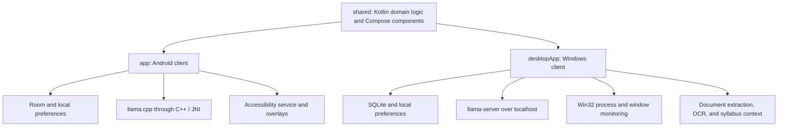

# Anchor

**An Android and Windows planner with local AI, syllabus records, focus timers, and app blocking.**

Anchor combines task planning, calendar-aware scheduling, syllabus extraction, an offline AI runtime, platform-specific app blocking, and persistent progress tracking. It is intended to support starting work and returning to it after an interruption.

**Android + Windows · Kotlin + Compose · Local GGUF inference · Room + SQLite**

[Project case study](docs/project-case-study.md) · [Development and installation](docs/development.md) · [Android blocking rules](docs/mobile-blocking.md)

## Editions and branches

The `main` branch contains the SDK-free **AGPL-3.0-only** edition. Android uses Health Connect and the device Calendar Provider. The public [`codex/vendor-integrations` branch](https://github.com/chentaot1/Anchor/tree/codex/vendor-integrations) contains direct Samsung Health and Google integration source, with a scoped AGPLv3 linking permission. Obtain Samsung's SDK directly for local builds; vendor SDK binaries, credentials and personal defaults must stay out of new commits on both branches.

**Maintenance status:** The SDK-free edition on `main` is provided as an unmaintained snapshot. Active development focuses on `codex/vendor-integrations`. This SDK-free edition does not receive regular updates or support. Current branches use clean source snapshots. Android preview 5 and Windows 1.0.6 remain GPLv3 releases with matching source archives; older pre-GPL downloads are removed.

See [edition boundaries and development workflow](docs/editions.md).

## Latest source update

**Latest releases per platform: Android 1.1.0-preview.5 · Windows 1.0.6 · October 12, 2026**

- These retained releases use GPLv3 with bundled third-party notices. Current branch source uses AGPLv3. Proprietary Samsung Health and Google Play Services SDKs are replaced by Health Connect and the device Calendar Provider.
- All plant models and the forest gallery are removed. Focus rewards continue without planting entries; the harbor uses original Compose geometry.

- Transfer supported tasks, assignments, focus history, and fun links between Android and Windows using JSON backups.
- Paste a syllabus into Android's Plan screen. Both parsers handle September abbreviations, explicit date years, and point/decimal weights without treating page or chapter ranges as dates.
- Android shared quota groups synchronize their daily allowances, show remaining rule-freeze time, and cap leisure purchases at the 4 AM reset.
- Windows focus timers measure awake time, recover interrupted sessions paused, and save focus credit with identities that prevent duplicate history. Daily progress uses the local 4 AM boundary.
- Home, Rescue, Airlock, routed actions, and Milestones retain pending work across navigation. Task saves, NOW selection, completion, and Undo await atomic database acknowledgement; captured-task identities survive Undo.
- Windows offers exact one-through-240-minute durations, compact layouts, and scrollable custom entry. Use Ctrl+K for Airlock, Ctrl+1–7 for navigation, Ctrl+I for Floating Island, and Space to start/pause focus.
- Desktop backup replacement validates data and saves a safety backup; single-instance startup, updater failure handling, native icons, and packaged Access Bridge support are improved.

Download [Windows 1.0.6 installers](https://github.com/chentaot1/Anchor/releases/tag/windows-v1.0.6) or the [Android preview 5 APK](https://github.com/chentaot1/Anchor/releases/tag/android-v1.1.0-preview.5). Both are built from sanitized public source. See the [Android preview notes](docs/releases/android-1.1.0-preview.5.md), [Windows notes](docs/releases/windows-1.0.6.md), and [detailed Windows verification](docs/windows-improvements.md) for changes and verification limits.

## From an assignment to a focus session

1. **Capture the work.** Add a task, collect a brain dump, import course material into the desktop syllabus workspace, or paste a syllabus into Android's Plan screen.
2. **Choose a starting action.** Break work into smaller steps and organize it into tasks, milestones, or a timeline.
3. **Protect the session.** Start a focus timer and apply the configured app or website restrictions.
4. **Return to the plan.** Replan unfinished work, review focus history, and build progress in the harbor screen.

Desktop task breakdown passes the full task text to the model prompt. Relevant pending syllabus records can supply saved deadlines and preparation steps to the AI.

## What the project includes

### An AI workspace for planning

Five planning workflows are implemented: **Break Down**, **Brain Dump**, **Triage**, **Replan**, and **Ask Anchor**. Supported commands such as a timer request can route directly to an action without an extra model-classification request.

The AI runs locally through **llama.cpp**. Windows manages a background `llama-server` process over localhost; Android runs inference through a native **C++/JNI** library. Structured workflows use **GBNF grammars** to constrain the shape of the response. Desktop task breakdown also validates the result and falls back to a task-specific draft when the model is unavailable or returns invalid steps.

These workflows connect to the planner: users can turn a brain dump into tasks, save breakdown steps as milestones, and start a focus session from a suggested action. Android also keeps AI job records and chat history locally. Supported planning changes have a persisted undo stack, including task creation, completion, inbox moves, and scheduling.

### A syllabus workspace with academic context

The desktop client extracts text from **PDF, DOCX, images, and text files**, with a Windows OCR fallback for scanned material. It parses course information and deliverables into records containing dates, item types, weights, and preparation steps.

Android accepts pasted syllabus text or schedule tables in **Plan → Assignments**, imports assignments with preparation notes, and supports deleting individual assignments. Both platforms honor explicit years in dates and accept `Sept`/`Sept.` and point or decimal weights.

The workspace includes course filters, completion tracking, an upcoming major-deliverable card, and direct focus-session starts from preparation steps. Exams, projects, homework, and readings receive different preparation templates. These are planning aids based on the item type; review them against the assignment before starting work. The parser does not automatically schedule them.

The AI context selects relevant incomplete items from those saved records by course and date. Supported deadline questions use deterministic answers from the saved dates. Imported text is treated as data, and missing assignment requirements still need the user's input.

### App and window blocking

**Windows:** foreground process and window monitoring, separate executable and browser-title rules, study schedules, usage allowances, rescue windows, earned leisure, and experimental focus-scope classification. Website rules apply to recognized browsers, so a desktop application and a browser tab with the same name keep separate identities. Scope checks run during active focus sessions.

Scope classification combines cached keyword decisions with a local-model fallback. Decisions use the current task and user classifications, with no preferred or excluded academic subjects. New profiles have no saved courses, schedules, leisure links, or protection rules; users add their own. Browser matching uses window titles, so it is a heuristic rather than URL-level enforcement.

**Android:** an Accessibility service enforces app rules, focus protection, standing shields, overnight curfews, weekday study windows, individual or grouped daily allowances, rule freezes, and a lock until the next local 4 AM. Foreground usage and earned leisure persist across restarts. [Full Android policy and precedence](docs/mobile-blocking.md).

The two clients use separate local data and settings. JSON backup import transfers supported records between them, including task, assignment, focus-session and fun-link data. Import converts minutes/seconds and maps companion/harbor progress fields; it is not a lossless transfer of every platform-specific field or setting. Android protection operates on apps; desktop website matching and scope classification are platform-specific.

### Planning, recovery, and visible progress

Tasks, assignments, routines, milestones, inbox/someday work, focus timers, and replanning support the work around each session. Android adds several connected systems:

- **Calendar-aware scheduling:** find the next gap that fits a task or a sequence of subtasks, accounting for scheduled work and imported events. Work that cannot fit before the configured shutdown stays unscheduled. Workload calculations merge overlapping time intervals to avoid counting the same busy time twice.
- **A recovery flow:** the Airlock captures a brain dump, parks secondary tasks, selects a primary task and a physical starting action, then starts focus. A deterministic starter is available immediately; local AI can refine it asynchronously, and starting focus cancels that refinement.
- **Habit and reflection tools:** scheduled habits, weekly targets, grace allowances, a 12-week heatmap, energy/tag check-ins, weekly summaries, and planned-versus-actual focus-time statistics.
- **Capture and integrations:** a home-screen widget, share-to-inbox capture, device-calendar occupancy, optional Health Connect step/exercise habits, and JSON backup export/import of planning records, routines, habits, focus history, companion progress, and fun links. Google calendars can be read when synced to the device calendar. Supported backup records can also be imported across Android and Windows.

The companion and harbor screens display progress and saved focus rewards using shared Compose drawing/animation components. Plant models, the forest gallery and its rendering dependencies have been removed. Legacy forest records remain readable in old backups.

## Engineering decisions

- **Deterministic command routing.** Supported commands run without model classification, and desktop breakdown returns a task-specific template when inference cannot complete.
- **Validation beyond output formatting.** The desktop parser checks step counts, empty or duplicate steps, preservation of the first action, and consistency of optional action/time fields. A grammatical response can still be irrelevant, so plans remain reviewable.
- **Context tied to saved records.** Syllabus context is bounded and selected from the same records shown in the desktop workspace, rather than relying on the model to remember course deadlines.
- **Platform-specific enforcement.** Windows uses Win32 APIs through JNA; Android uses Accessibility events and overlays. Shared Kotlin code supplies common domain logic, design components, and progress visuals.
- **A native inference lifecycle.** Android serializes generation, reuses an already loaded model, streams tokens through JNI, supports cancellation, and unloads the warm model after an AI surface has been closed for two minutes. The native layer clears each request's KV cache, rejects invalid grammars instead of silently generating unconstrained JSON, and buffers incomplete UTF-8 token fragments before sending text to Kotlin.
- **Desktop inference configuration.** The client manages server startup, health checks, model changes, and shutdown. Its default CPU profile uses a 2,048-token context, one server slot, quantized KV caches, and disabled reasoning. Memory use and response time depend on the model and hardware.
- **Model asset verification.** Android packages a pinned GGUF asset and verifies its size and SHA-256 before activating the extracted model. The native llama.cpp source archive is pinned and hash-checked too.

A concrete debugging example: an assignment breakdown once copied unrelated prompt examples about dishes and a coding test. That led to changes in task routing, prompts, validation, and regression coverage. The [case study](docs/project-case-study.md) explains the failure, the response, and the remaining limits of semantic validation.

## Architecture



Useful entry points:

- **AI and routing:** [desktop AI module](desktopApp/src/main/kotlin/com/anchor/adhd/desktop/ai), including `DesktopSmartRouter`, `DesktopAiEngine`, and `LlamaServerClient`.
- **Academic context:** [DesktopAcademicContext](desktopApp/src/main/kotlin/com/anchor/adhd/desktop/ai/DesktopAcademicContext.kt) and [DesktopSyllabusParser](desktopApp/src/main/kotlin/com/anchor/adhd/desktop/ai/DesktopSyllabusParser.kt).
- **Windows enforcement:** [DesktopProcessMonitor](desktopApp/src/main/kotlin/com/anchor/adhd/desktop/blocker/DesktopProcessMonitor.kt).
- **Shared domain and UI:** [shared module](shared/src/commonMain/kotlin/com/anchor/adhd).
- **Android native inference:** [C++/JNI runtime](app/src/main/cpp).
- **Android scheduling and undo:** [PlanRepository](app/src/main/java/com/anchor/adhd/data/repository/PlanRepository.kt), [SchedulingSlots](app/src/main/java/com/anchor/adhd/domain/SchedulingSlots.kt), and [ChatUndoManager](app/src/main/java/com/anchor/adhd/domain/ChatUndoManager.kt).
- **Recovery and progress:** [AnchorViewModel](app/src/main/java/com/anchor/adhd/ui/vm/AnchorViewModel.kt), [HabitScoreCalculator](app/src/main/java/com/anchor/adhd/domain/HabitScoreCalculator.kt), and [GrowRepository](app/src/main/java/com/anchor/adhd/data/repository/GrowRepository.kt).

## Run the desktop client

Use **JDK 17** and an Android SDK configured in your ignored `local.properties`; the repository includes Android modules even when running desktop tasks. Detailed prerequisites and Android build steps are in the [development guide](docs/development.md).

```powershell
git clone https://github.com/chentaot1/Anchor.git
cd Anchor
.\gradlew.bat :desktopApp:test
.\gradlew.bat :desktopApp:run
```

Desktop unit tests do not require model weights. To enable local AI, configure a compatible `llama-server.exe` and a GGUF file in Settings. Build a Windows application image with `:desktopApp:createDistributable`; `Launch-Anchor.bat` starts that image when available and otherwise uses Gradle.

Models, runtime binaries, build outputs, credentials, and personal databases are excluded from Git. Run the [publication privacy checks](docs/publication-privacy.md) before publishing. New Android APKs exclude model weights and offer an optional download during onboarding or later in Settings. Existing installed models are retained. The older GPL preview 5 APK still bundles its model. An Android-only repository is not needed for [F-Droid preparation](docs/fdroid.md).

## Validation and current status

The October 11 Windows update passed **323 desktop and 8 shared tests**. Native Windows checks exercised workflows at 900 by 600 and 640 by 450 dp, including retained drafts, failed saves and retry, timer identity, task selection, and compact controls. The application image, MSI, and EXE rebuilt locally; packaged JAR hashes match the source build and the Access Bridge runtime checker passes. Published packages include checksum assets and pass the release payload privacy screen.

The public-source privacy cleanup passed **223 Android unit tests on October 11**. The Android preview 5 APK was rebuilt for publication with native build paths remapped. Automated and isolated native checks do not establish physical-device blocking, actual screen-reader interaction, or every display scaling configuration. Document integration tests generate fictional PDF, scanned PDF and DOCX fixtures.

```powershell
.\gradlew.bat :desktopApp:test
.\gradlew.bat :app:testDebugUnitTest
.\gradlew.bat :shared:desktopTest
```

[Android CI](.github/workflows/android-build.yml) runs Android unit tests. APK publication is an opt-in tagged-release workflow. The desktop result above was verified locally; desktop tests are not currently part of that CI workflow.

Anchor is a personal project under development. Current desktop fixes require rebuilding an older installation. Generated plans and extracted syllabus dates need review, and native blocking still needs testing on the target devices. Scope classification is experimental and may produce false positives. There are no established learning-outcome or clinical efficacy claims.

## Further reading

- [Project case study](docs/project-case-study.md): motivation, tradeoffs, debugging, verification, and remaining work.
- [Development and installation](docs/development.md): SDK setup, desktop packaging, Android model bundling, and updates.
- [Android app protection](docs/mobile-blocking.md): rule precedence, daily reset, allowances, and earned leisure.
- [Android inference implementation](docs/desktop-model-on-android.md): pinned model, JNI behavior, host verification, and pending device checks.
- [Earlier product specification](FULL_APP.md): broader design intent; some details predate the current implementation.

## License

Anchor's original source code and documentation are licensed under [AGPLv3, version 3 only](LICENSE). See [NOTICE](NOTICE), the [dependency audit](docs/license-audit.md) and [third-party notices](licenses/THIRD_PARTY_NOTICES.txt). Third-party libraries, model weights and runtimes retain their respective licenses. Previously published MIT and GPLv3 grants remain valid; the prior MIT notice is preserved in [MIT-previous.txt](licenses/MIT-previous.txt).

See the [AGPL migration and retained GPL releases](docs/license-migration.md).
